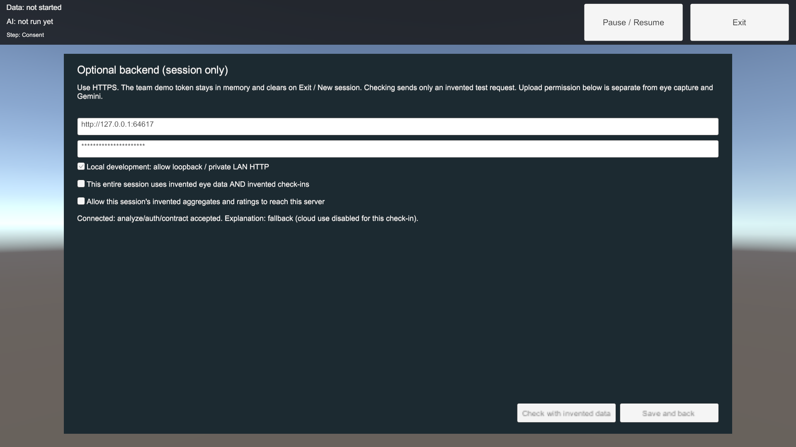

# Runtime backend settings and transfer consent (#20)

This branch adds desktop and Quest configuration to the merged Quest/report/replay baseline. It keeps the v1 HTTP contract, packaged replay loader, native-capture boundary and optional forest flow. Device setup/live eyes remain #18/#21.

## Configure before capture

At Consent, choose **Optional backend settings**. Enter the backend origin and a separate team-demo bearer token. The token field is masked and hides the platform's native input overlay. Choose explicit local development only for loopback/private-IP HTTP. Use HTTPS for a hosted endpoint; never disable certificate verification. Origins cannot contain credentials, query/fragment or an API path. `/api/v1/analyze` is appended by the client.

**Check with invented data** sends one bundled invented request to the actual analyze endpoint, with the runtime token, `cloud_policy: local_only`, no free text and a fresh random session ID. A connected status requires an accepted response schema/provenance/safety contract, not just health. It does not authorize uploading a session or start eye capture. HTTP auth/status, invalid response, network/timeout and local fallback use bounded diagnostics; arbitrary server bodies/headers are never shown.

To send a demo session, separately affirm that the entire session's eye input **and check-in are invented**, and permit upload to the configured server. Both are off by default. Only synthetic or synthetic-replay provenance may pass this client gate; live or recorded eye input remains on-device. Loopback also needs these flags because USB reverse forwarding can send its traffic to another machine. A synthetic eye label alone does not establish that a person's ratings are invented. Real participant sessions keep the on-device report; hosted participant data handling is not authorized by this feature.

**Save and back**, then start the assessment. Bad or declined backend configuration preserves a labelled local report. The forest is still separately chosen and unnecessary for completion. Interactive requests remain `local_only`: that prevents Gemini forwarding, not transport to a backend. The team token is demo access control, not production user authentication.

## Precedence and lifecycle

| Platform | Initial URL and token | Runtime override |
| --- | --- | --- |
| Desktop | URL: `-backendUrl` > `VR_BACKEND_URL` > non-secret Inspector default. Token: `VR_BACKEND_ACCESS_TOKEN` or empty. | Consent settings override in memory. No token command-line argument. |
| Android/Quest | Non-secret Inspector URL default, empty token. Desktop environment/launch settings are ignored. | Configure using the tracked UI/native keyboard before capture. |

No credentials or transfer consent are stored in PlayerPrefs, files, scenes, prefabs or source. Exit/New session/teardown clears token and upload flags; the non-secret URL may remain in memory. Pending connection checks are cancelled/invalidated on reconfiguration, capture start and reset. Existing report-request and packaged-replay reset guards are retained, so late work cannot revive a session.

The default loopback URL refers to the device running the app. A headset needs a reachable backend origin; a USB reverse mapping is an explicit development setup to verify, not proof of hosted HTTPS or a second network. HTTP requires development mode and a loopback/RFC1918 destination; public cleartext hosts are rejected. Redirects are disabled so credentials/summaries cannot be forwarded to a new endpoint.

## Source and generation

- `BackendSettings` validates origins/tokens and gates transfer; `ConfiguredBackendClient` returns local rules before network work when blocked.
- `HttpAnalysisClient` receives credentials explicitly, rejects redirects and records accepted backend responses for the invented check.
- `SessionController` retains settings only in memory and owns cancellation/reset.
- `ConsentPanel` exposes a separate settings overlay. `AssessmentSceneBuilder` generates it. **App > Update Backend Settings UI** updates only Consent and its scene reference; other panel prefabs are preserved. Full builds still use BuildAll.
- `Reports/Resources/backend-connection-probe.json` is the existing wholly invented fixture, checked for drift. It is a Unity TextAsset available in the APK without filesystem access to Android StreamingAssets.

## Verification and remaining acceptance

Automated checks cover settings normalization/rejection and precedence, nonserialized credential/consent fields, blocked upload before network work, authenticated native analyze checking, 401/403/422, invalid JSON/schema, redirects, timeout, reset during pending work, token clearing, local report completion and tracked settings navigation/layout. Existing packaged-replay, report-only, capture/metrics and HTTP regressions run alongside them. Tests use invented data and disable Gemini.

Physical Quest keyboard/masking/readability, a rebuilt Android APK and two-network HTTPS are separate unrun checks until evidence is recorded. #15 requires an authorized hosting target. #23's paid smoke remains separately budgeted; adding runtime backend settings does not enable Gemini.

For the on-device check: use the final branch APK, verify entering/editing URL/token without a rebuild, correct vs wrong/missing token, explicit declined upload, offline report-only completion, and Exit/New session during a pending check/request. Keep serials/tokens/private reports out of evidence. Record commit/APK hash, device/runtime versions, network/scenario, expected vs observed result and pass/fail/unrun.

## Recorded desktop check — October 25, 2026

Unity 6000.6.7f1/full pinned packages: **375 EditMode and 35 PlayMode tests passed, zero skips**. Backend: **150 tests**, Ruff and contracts passed (14 schemas, 35 fixtures, 7 invalid examples rejected). PlayMode used an authenticated loopback-only server, invented test credentials/requests and Gemini disabled. The actual generated settings overlay was rendered and inspected; the token is masked and both upload flags remain declined during the invented connection check. This is desktop UI/HTTP evidence, not a physical Quest or cross-network result.

