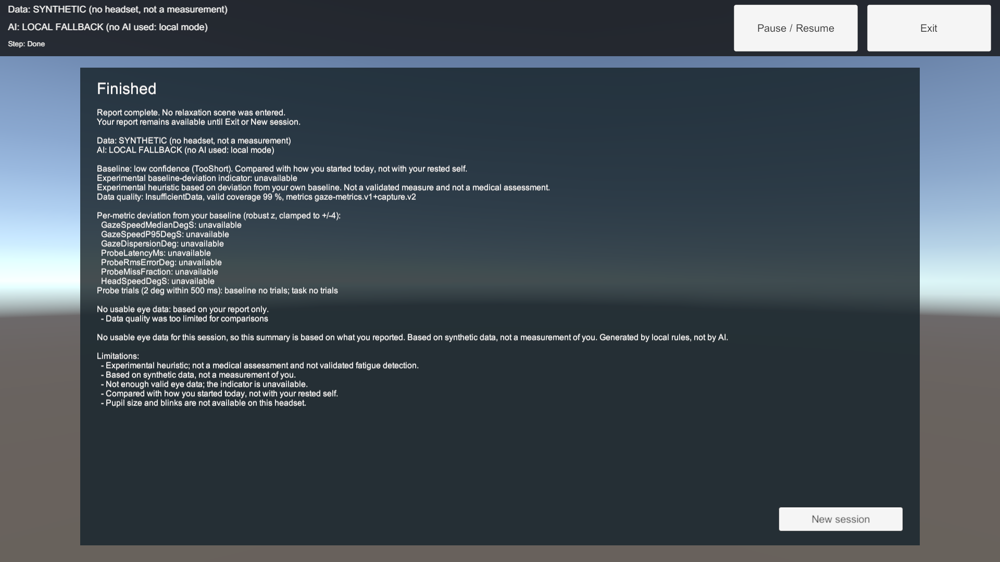
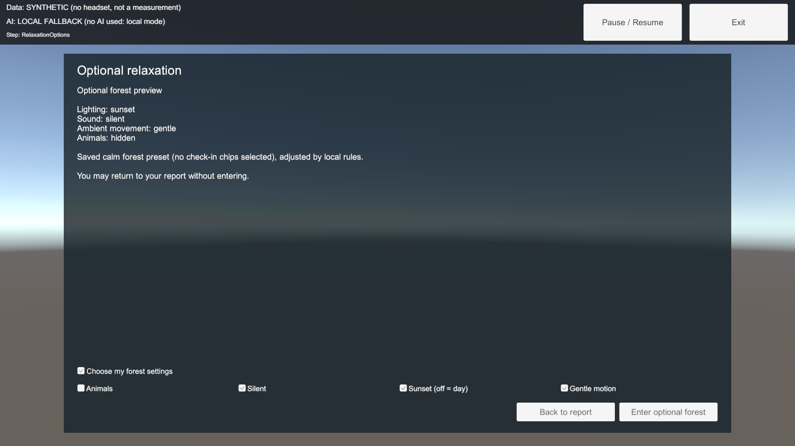

# Report-only desktop completion (#16)

The assessment now completes normally with its report. A forest is a separate optional use case. No headset, camera, Gemini key or paid provider call is needed for the desktop flow.

## Behavior

- Consent -> Baseline -> Task -> Check-in -> Summary -> **Finish with report** -> Done. No forest loads, scene preferences or post-scene feedback are required.
- Done retains the same measurements, limitations, safety information, data/AI provenance and calculation-failure notice. **Exit** or **New session** clears the report and recordings. Reports are never saved to disk by the app.
- **Try optional relaxation** opens a separate preferences/preview screen. **Back to report** declines it without loading a forest. **Enter optional forest** confirms entry and applies validated preferences locally.
- A stop-session notice blocks relaxation while preserving report completion and immediate Exit.
- Scene participants may submit feedback or choose **Skip feedback**; no after-scene rating is invented.
- Pending analysis disables report completion. Exit cancels it; a late result cannot revive a reset session or overwrite its progress state. Analysis errors expose an exception type only.

The required v1 scene configuration/rationale remains on the wire; the report formatter ignores it. Scene preferences are no longer collected during check-in or needed for report generation. No JSON schemas, DTO fields or backend request models change.

## Implementation

`SessionFlow` provides the report-only transition, explicit RelaxationOptions state, scene-entry guard and optional feedback. `SessionController` retains/clears data at the appropriate actions and rejects stale async completions. `AssessmentSceneBuilder.BuildAll` generated Assessment, all panel prefabs and the new RelaxationOptionsPanel assets in Unity 6000.6.7f1. Existing asset GUIDs are preserved; no serialized YAML/GUIDs were hand-edited.

Shared status docs were updated during integration so the former scene-required flow is no longer described as current behavior.

## Desktop verification

- Combined PRs #19, #24 and #25: **321 EditMode tests**, **150 backend tests**, Ruff and contracts passed before this follow-up.
- Report-only state regressions: **327 EditMode tests passed**, no skips, on Unity **6000.6.7f1** and the full pinned package graph.
- Final PlayMode results: **19 passed, no skips**, on the same pinned Unity editor..
- Backend tests: **150 passed**; Ruff passed for app/tests/scripts. Contracts: **14 schemas, 35 fixtures, 7 deliberately invalid examples rejected**; no C# reports regenerated during this integration.
- The native HTTP tests used a loopback-only backend in hosted mode, a synthetic test token, Gemini disabled and invented requests. They exercise successful backend rules, auth/422 handling, invalid responses, network fallback, replay, unavailable calculations and report/forest paths.
- Added coverage includes report-only completion without a forest, report retention/reset, preview/back/entry controls, local preference overrides, skipped feedback, stop-session completion and Exit during a pending HTTP request.
- Screenshot evidence below uses synthetic short sessions with honest insufficient-data and fallback labels. The test helper renders the actual generated UI through the pinned render pipeline into a texture for batch-mode capture; it does not change the committed scene. These are desktop UI checks, not VR readability or comfort evidence.

Commands (backend running at a loopback test URL with Gemini disabled):

```sh
Unity -batchmode -nographics -projectPath unity -runTests -testPlatform EditMode -testResults /tmp/editmode.xml -logFile /tmp/editmode.log
VR_RUN_BACKEND_TESTS=1 VR_SMOKE_BACKEND_URL=http://127.0.0.1:8127 VR_UNITY_BACKEND_TEST_URL=http://127.0.0.1:8127 Unity -batchmode -projectPath unity -runTests -testPlatform PlayMode -testResults /tmp/playmode.xml -logFile /tmp/playmode.log
```

Supply the matching test token privately through `VR_BACKEND_ACCESS_TOKEN`; do not put actual credentials in commands, assets or screenshots. To regenerate the optional synthetic evidence, set `VR_UI_SCREENSHOT_DIR` to a local output directory.





## Separate remaining work

- #18/#21: XR rig, app live-eye provider, Android and headset acceptance. Rendering/foveation does not prove live assessment capture or measured 90 FPS.
- #15: actual HTTPS deployment and two-network evidence. This integration does not deploy a service.
- #20: runtime endpoint/token configuration and a client-side participant-transfer consent gate. `local_only` blocks Gemini forwarding, not HTTP upload. Keep hosted staging limited to wholly invented requests; do not point participant sessions at it. Live/recorded input remains rejected by hosted staging.
- #17/#22: forest asset/license audit, generated forest visual checks and eventual device profiling.
- #23: any live Gemini smoke requires its separate bounded authorization; all checks here kept Gemini disabled.
